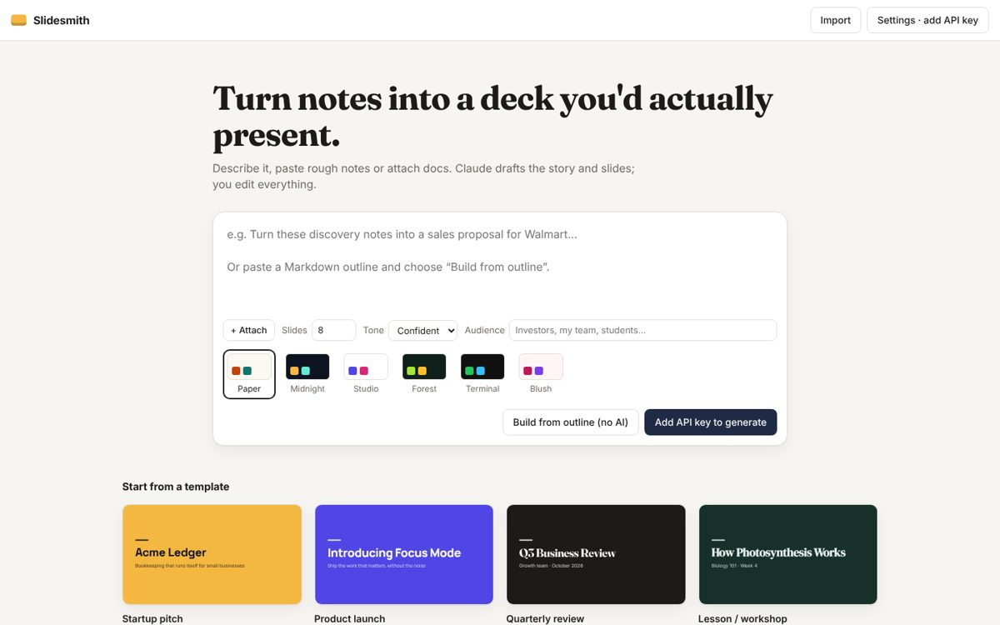
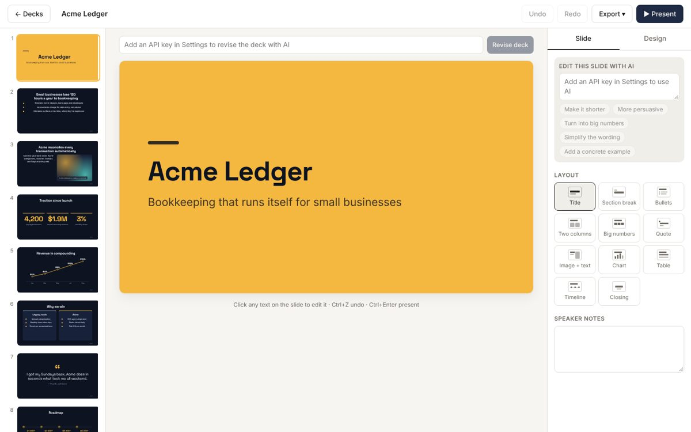
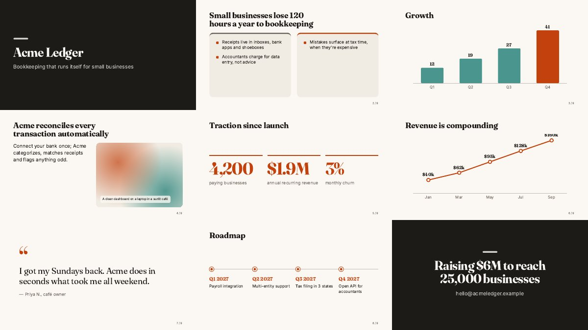

# Slidesmith

**An open-source AI deck maker.** Describe a deck, paste rough notes or attach docs; Claude drafts the story and the slides; you edit everything in place, present it, and export it to PowerPoint, PDF or a single web page.

Inspired by the workflow of AI presentation tools like Chronicle (start from anywhere → generate → edit with AI → share in any format), built from scratch with its own design. No account, no server: your decks and your API key stay in your browser.




## What it does

- **Generate with AI.** A prompt, notes, or attached files (PDF, Markdown, text) become a structured deck. Claude picks layouts that fit the content (big numbers, charts, comparisons, timelines, quotes), writes slide titles as claims, and adds speaker notes. Choose slide count, tone, audience and theme.
- **Build from an outline, no AI needed.** Paste Markdown and get a real deck. Headings, bullets, tables, quotes, images and ```` ```chart ```` blocks are recognized automatically ([format below](#outline-format)).
- **Edit in place.** Click any text on the slide to change it. Switch a slide's layout and its content carries across (bullets split into columns, `2024: launch` bullets become a timeline…). Charts, tables, timelines and stats have their own editors in the side panel.
- **Edit with AI.** Rewrite one slide ("make it shorter", "turn into big numbers") or revise the whole deck ("cut to 6 slides for a 5-minute talk"). Every AI change is one undo step.
- **11 layouts**: title, section, bullets, two columns, big numbers, quote, image + text, chart (bar/line/donut), table, timeline, closing.
- **6 themes + a brand kit**: your colors, fonts, logo and footer on every slide.
- **Present**: full screen, keyboard/click navigation, fade or slide transitions, speaker notes (`N`).
- **Export**:
  - **PowerPoint (.pptx)** with native, editable text boxes, tables and charts (not screenshots), plus speaker notes
  - **PDF** through the browser's print dialog, pixel-identical to the editor
  - **Web page (.html)**: one self-contained file you can host anywhere or email; arrow keys, swipe, `N` for notes, `F` for full screen
  - **Markdown** outline and **.json** (re-importable)
- Undo/redo, drag-to-reorder, duplicate (`Ctrl+D`), autosave, works on phones.



## Run it

```sh
cd deck
npm install
npm run dev        # http://localhost:5173
npm test           # 28 tests: outline parser, layouts, PPTX/HTML export, AI request shape
npm run build      # static site in dist/, deploy anywhere (Vercel, Netlify, GitHub Pages)
```

For AI features, open **Settings** and paste an Anthropic API key ([console.anthropic.com](https://console.anthropic.com/settings/keys)). Pick Claude Opus 5.5 (default, best), Sonnet 5.5 (faster) or Haiku 5.5 (cheapest). Everything else works without a key.

## Outline format

```md
# Deck title                 ← first H1: title slide (next line = subtitle)
A one-line promise

## Slides are H2 headings    ← one slide each; `---` also starts a slide
- bullets become bullet slides

## Traction
- **4,200** customers        ← all bullets start with a bold value → big numbers
- **$1.9M** ARR

## Roadmap
- Q1 2027: Payroll           ← 3+ "date: text" bullets → timeline
- Q2 2027: Multi-entity
- Q3 2027: Tax filing

## Before and after
### Before                   ← two H3 lists → two columns
- slow
### After
- fast

> "Quote text"               ← quote slide
— Name, title

## Revenue
```chart line              ← bar | line | donut
unit: $k
Jan: 40
Feb: 62
```

| Plan | Price |               ← table slide
| --- | --- |
| Pro | $12 |

     ← image + text slide
<!-- layout: closing -->      ← force any layout
Notes: speaker notes go after this line
```

## How it's built

| Piece | Where |
|---|---|
| Deck/slide model | `src/types.ts`, `src/slides.ts` (normalizing, layout switching) |
| Markdown ⇄ deck | `src/outline.ts` |
| Claude integration | `src/ai.ts`: `@anthropic-ai/sdk` from the browser with structured outputs (a Zod schema of the deck), adaptive thinking with per-task effort, and server-side refusal fallbacks |
| Slide rendering | `src/components/SlideView.tsx` + `src/slide.css`: one renderer for the editor, presenter, PDF and HTML export |
| Exports | `src/export/pptx.ts` (pptxgenjs), `src/export/html.ts` |
| UI | React 18 + Vite, plain CSS; AI and export code is lazy-loaded (~65 KB gzipped to start) |

**Privacy:** the API key lives in this browser's `localStorage` and is sent only to `api.anthropic.com`. Decks are saved in `localStorage` too; export `.json` to back up or move them.

## Research

The product was studied in clean-room mode with [Craft Anything](https://github.com/storytold/craft-anything), which only looks at what a visitor sees and never at source. Notes are in [docs/research.md](docs/research.md).

## Not yet

- Live multi-user collaboration and share links with view analytics (needs a backend)
- Importing existing .pptx files
- AI image generation (image slides take a URL or an upload; the AI suggests what the image should show)
- Templates saved from your own decks
