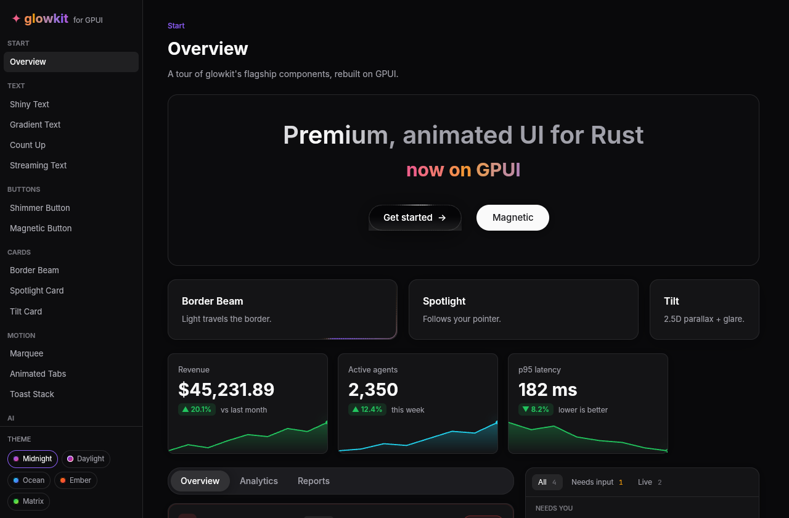
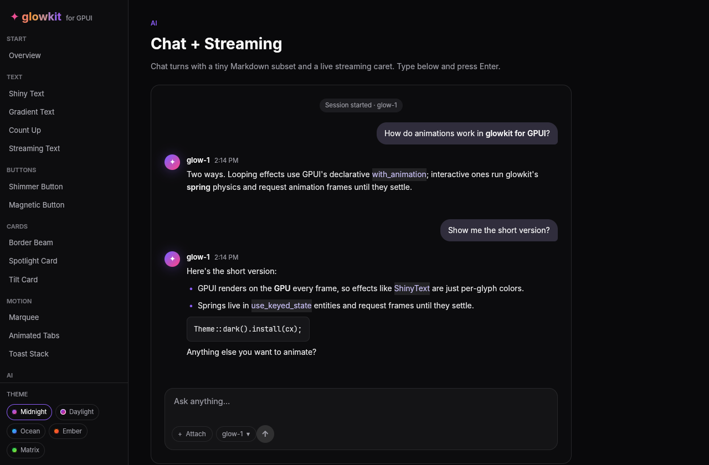
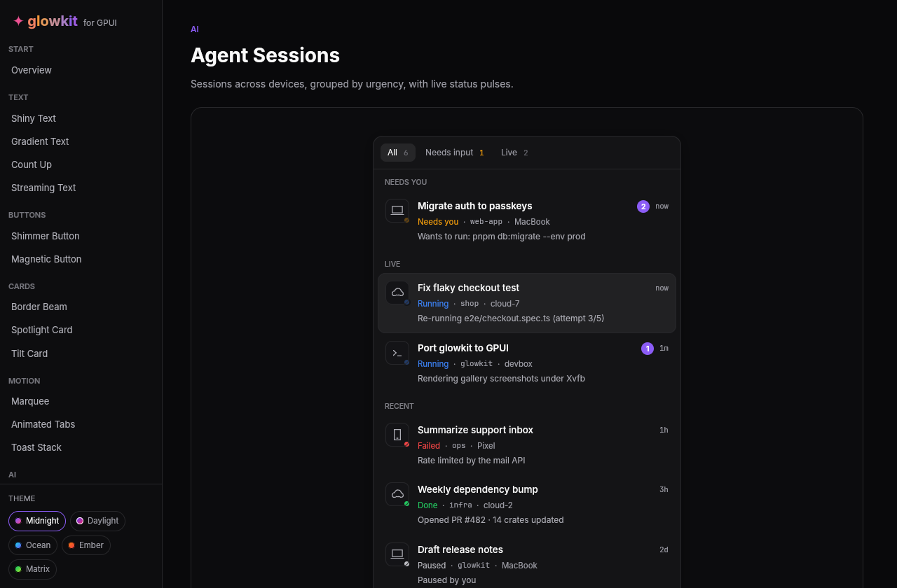

# glowkit for GPUI

A port of glowkit's design language and 16 of its flagship animated components to
[GPUI](https://crates.io/crates/gpui), the GPU-accelerated UI framework behind the Zed editor.
glowkit itself is built on egui; this is a separate cargo workspace (the main workspace
excludes `ports/`) that depends only on `gpui = "0.2.2"`.



## What's ported

| Area | Ported from glowkit | Notes |
|---|---|---|
| Theme tokens | `glowkit_core::theme` | Same semantic tokens and hex values. 5 presets: Midnight (dark), Daylight (light), Ocean, Ember, Matrix. Stored as a GPUI `Global`, read with `cx.theme()`. |
| Color math | `glowkit_core::color` | `hex`, OKLab `mix`, `gradient`, `gradient_cyclic`, `shade`, `contrast_text`, palettes, all on `gpui::Hsla`. |
| Motion math | `glowkit_core::anim` | The 31 easing curves, `Spring` (same integrator and defaults), `approach`, `stagger` and `smoothstep`, copied verbatim. |

### Components

| Component | Kind | How it animates |
|---|---|---|
| `ShinyText` | `RenderOnce` | `with_animation` loop. A highlight band is drawn as per-glyph colors through `StyledText::with_highlights`. |
| `GradientText` | `RenderOnce` | `with_animation` loop. A cyclic OKLab gradient is applied per glyph. |
| `CountUp` | `RenderOnce` | A one-shot `with_animation` keyed by the value, so it replays whenever the value changes. Uses glowkit's easings. |
| `StreamingText` | `RenderOnce` | Typewriter reveal with a caret. The unrevealed tail stays laid out but invisible, so the text never reflows. `live(true)` gives a pulsing caret for text that is still streaming in. |
| `ShimmerButton` | `RenderOnce` | A spark circles the border on a canvas: per-segment stroked paths plus an analytic-shadow glow. An inner highlight brightens on group hover. |
| `MagneticButton` | `RenderOnce` + keyed state | Uses glowkit's "bouncy" spring (300/12) in a `window.use_keyed_state` entity. Pointer moves set the spring target, and the component requests frames until the spring settles. |
| `BorderBeam` | container (`ParentElement` + `Styled`) | Copies the beam profile from glowkit: a soft head and a smooth tail that blends between two colors. |
| `SpotlightCard` | container | A pointer-following glow (blurred-disc shadow) that also lights the nearby border. Opacity uses `approach` with the same timing as glowkit's `follow`. |
| `TiltCard` | container | **2.5D emulation.** GPUI elements can't take 3D or affine transforms. The card shifts with parallax, a glare comes from the side the pointer is on, and the shadow moves the opposite way and grows as the card "lifts". All of this is driven by springs. |
| `Marquee` | `RenderOnce` + keyed state | Scrolls endlessly with faded edges. On hover it eases to a stop. Chip widths are measured with `text_system().shape_line`. |
| `AnimatedTabs` | `RenderOnce` + keyed state | Pill, Solid and Underline styles. The leading and trailing edges run on springs with different stiffness, so the highlight stretches as it moves (a port of glowkit's algorithm). |
| `ToastStack` | `Render` view | Sonner-style stack. Toasts spring in, older ones tuck into a deck, and the stack fans out on hover (which also pauses the timers). Each toast has a progress bar and a close button. Call `push(Toast, cx)` to show one. |
| `ChatMessage` | `RenderOnce` | User bubble, assistant avatar and header, a small Markdown subset (paragraphs, `- ` bullets, fenced code, `**bold**`, `` `code` ``), a live streaming caret, and an action row that appears on hover. |
| `PromptInput` | `Render` view, `Focusable` | Animated focus ring and send/stop button. Emits `PromptSubmit(String)` and `PromptStop`. Typing is handled from key-down events: printable keys, Backspace, Enter (sends), Shift+Enter (new line) and Escape. It has no IME support, selection or cursor movement. |
| `ApprovalCard` | `RenderOnce` | Shows the agent, tool, command, reason, risk badge and wait time. While pending, its border pulses in the risk color. Has approve and deny callbacks and a decided state. |
| `AgentSessionList` | `RenderOnce` + keyed state | All / Needs input / Live tabs with counts. Rows are grouped into "Needs you", "Live" and "Recent" sections. Each row has device glyphs drawn as canvas paths, a pulsing status dot and an unread badge. |
| `StatTile` + `Sparkline` | `RenderOnce` | A count-up value and a delta badge (`invert_delta` flips which direction counts as good). The sparkline is an area chart with a gradient fill that draws itself in. |

## Usage

```toml
[dependencies]
gpui = "0.2.2"
glowkit-gpui = { path = "ports/gpui/crates/glowkit-gpui" }
```

```rust
use glowkit_gpui::prelude::*;
use gpui::{prelude::*, div, px, App, Application, Context, Window, WindowOptions};

struct Hero;

impl Render for Hero {
    fn render(&mut self, _: &mut Window, cx: &mut Context<Self>) -> impl IntoElement {
        let t = cx.theme();
        div().size_full().bg(t.background).font_family(t.font_family)
            .flex().flex_col().items_center().justify_center().gap(px(16.))
            .child(ShinyText::new("hero", "Hello from GPUI").size(48.0))
            .child(ShimmerButton::new("cta", "Get started").on_click(|_, _, _| println!("clicked")))
            .child(BorderBeam::new("card").w(px(320.)).p(px(20.)).child("Light travels the border"))
    }
}

fn main() {
    Application::new().run(|cx: &mut App| {
        Theme::dark().install(cx); // or Theme::light(), ocean(), ember(), matrix()
        cx.open_window(WindowOptions::default(), |_, cx| cx.new(|_| Hero)).unwrap();
    });
}
```

Stateless components take an `ElementId`. It keys their `with_animation` state or the entity
they keep in `use_keyed_state`, so give each instance a unique id. Interactive components ask
for animation frames only until their springs settle.

## Gallery

```bash
cd ports/gpui
cargo run -p glowkit-gpui-gallery                             # overview, Midnight
cargo run -p glowkit-gpui-gallery -- --page chat --theme daylight
```

The window has a sidebar with every component and a theme switcher, plus a preview pane. Page
slugs: `overview shiny-text gradient-text count-up streaming-text shimmer-button
magnetic-button border-beam spotlight-card tilt-card marquee animated-tabs toasts chat
prompt-input approval sessions stat-tile`.

## Build notes

* **Linux system libraries.** On Debian or Ubuntu, `gpui` needs these to compile:
  `libxkbcommon-dev libxkbcommon-x11-dev libwayland-dev libvulkan-dev libx11-xcb-dev libxcb1-dev
  libfontconfig-dev libfreetype-dev pkg-config clang cmake`.
* **`xattr` patch.** `gpui 0.2.2` pulls in `xattr 0.2.3` through `zed-async-tar`. That crate
  references `libc::ENOATTR`, which current `libc` (0.2.191) no longer exports on Linux, and
  `rustix` and `nix` stop you from downgrading `libc`. `patches/xattr` is a verbatim copy with
  that one constant mapped to `ENODATA` (the same errno on Linux), wired in with
  `[patch.crates-io]`.
* **Headless rendering.** `scripts/screenshot.sh OUT_DIR page[:theme]...` runs the gallery
  under Xvfb with Mesa lavapipe, the software Vulkan driver (`mesa-vulkan-drivers`, `xvfb`,
  `xdotool`, `imagemagick`). When there is no window manager, gpui 0.2 misses the window's first
  `MapNotify` and never starts its frame loop. The script unmaps and remaps the window to get it
  started.

## Status and verification

* `cargo clippy --workspace -- -D warnings` passes. `cargo test -p glowkit-gpui` passes: OKLab
  round-trip, hex parsing, easing endpoints, spring convergence and stagger.
* **Rendered and checked visually:** every gallery page was rendered under Xvfb with lavapipe
  and the screenshots were inspected, in Midnight, Daylight, Ocean, Ember and Matrix. Looping
  animations were confirmed running: shimmer spark, border beam, marquee, toasts and the
  streaming reply.
* **Not verified:** hover and pointer interactions (magnetic pull, spotlight, tilt, tab clicks,
  group-hover rows), keyboard typing in `PromptInput`, and clicks. With no XInput pointer
  device, synthetic `xdotool` pointer moves didn't show any hover effect in the screenshots. The
  code paths compile, but nobody has seen them work. Nothing has been tested on macOS, Windows,
  Wayland or a real GPU.
* The visual comparison with the egui gallery was limited to the shared tokens: the same zinc
  palette, accent, gradient, radius and Inter typography. The GPUI gallery is a separate app,
  not a pixel-for-pixel copy.



